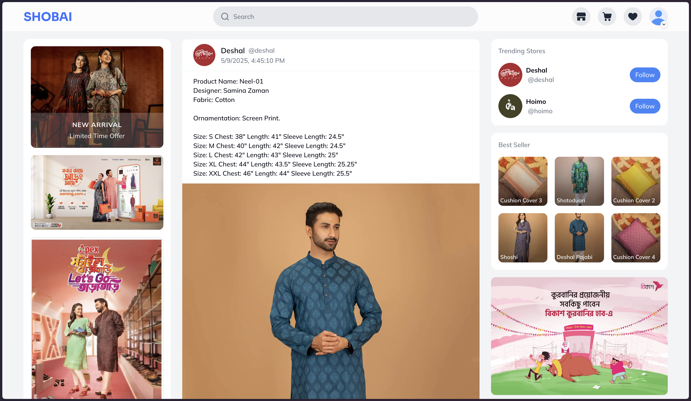
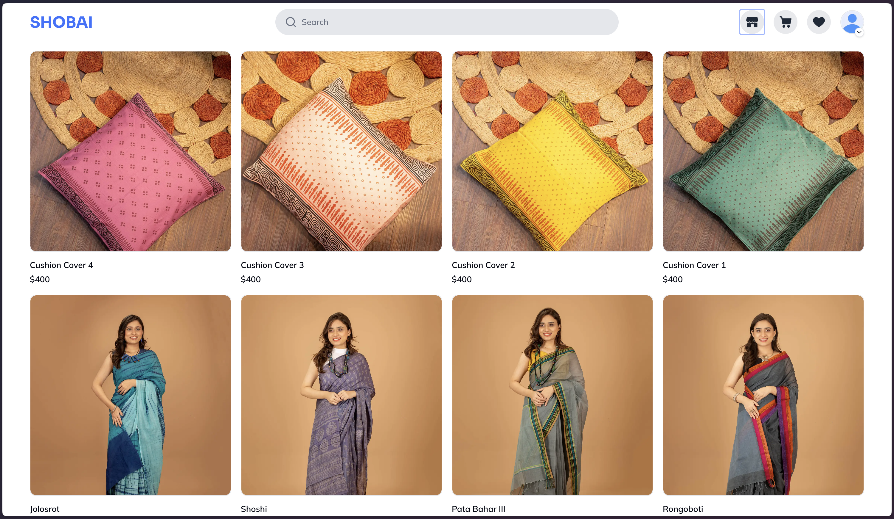

# SHOBAI - SME Marketplace

A digital marketplace designed to help Small and Medium Enterprises (SMEs) in Bangladesh establish their online presence, showcase products, and connect with customers.

**Live Demo:** [SHOBAI](https://shobai-sme.vercel.app/)

<p align="center">
   <picture>
      
   </picture>
   <picture>
      
   </picture>
</p>

## Tech Stack

**Prerequisites** \
Make sure you have the following installed:

- Git
- Node.js 18.18+
- npm
- Convex Account

**Frontend**
- Next.js 15 - React framework and application routing
- React 19 - UI development
- TypeScript - Type safety
- Tailwind CSS v4 - Styling
- Shadcn UI - Accessible UI components
- Framer Motion - UI animations
- Lucide React - Icons

**Backend**
- Convex - Backend and reactive database
- Convex Auth - Authentication and session management
- Google OAuth - Social authentication
- Cloudinary - Image and media integration
- Zod - Data validation
- React Hook Form - Form management


## Key Features

- User registration and login with Google authentication.
- Product browsing and store exploration.
- Merchant application and admin approval system.
- Store creation and management.
- Product and inventory management.
- Shopping cart and wishlist.
- Store following and post interactions.
- Role-based access for Users, Merchants, and Admins.

**Problems Solved**

- Limited digital presence of small and medium businesses.
- Difficulty discovering products from different local businesses.
- Lack of a unified platform for merchant and product management.
- Limited customer engagement between businesses and potential buyers.
- Unorganised product saving and shopping cart management.

## Run Locally

**1. Clone the repository**

```bash
git clone https://github.com/Arefin40/SHOBAI.git
cd SHOBAI
```

**2. Install dependencies**

```bash
npm install
```

**3. Configure Convex**

```bash
npx convex dev
```

Configure your Convex deployment and required authentication credentials. Set `NEXT_PUBLIC_CONVEX_URL` in `.env.local` if it is not generated automatically.

**4. Start the development server**

```bash
npm run dev
```

Visit: `http://localhost:3000`

**5. Production build**

```bash
npm run build
npm run start
```

## Challenges Faced During Development

- One of the major challenges was to ensure that orders were confirmed only after successful payment verification, even if a customer left the checkout page midway. Server-side Stripe webhooks with cryptographic signature verification solved this issue by allowing the backend to update order statuses and stock levels after verified payment events.

- Another significant challenge was to maintain fast page loads despite dynamic social feeds and image-heavy product catalogs. Next.js Server Components, pagination, and indexed PostgreSQL queries helped reduce client-side JavaScript and improve Time to First Byte (TTFB), particularly on mobile networks.

- A further challenge was to separate customer and merchant permissions without reducing access to public storefronts. Custom NextAuth.js session callbacks and server-side route guards enforced role-based access and protected restricted features.

**Live Demo:** https://shobai-sme.vercel.app/ 

**SHOBAI - Empowering Small Businesses, Connecting Opportunities.**